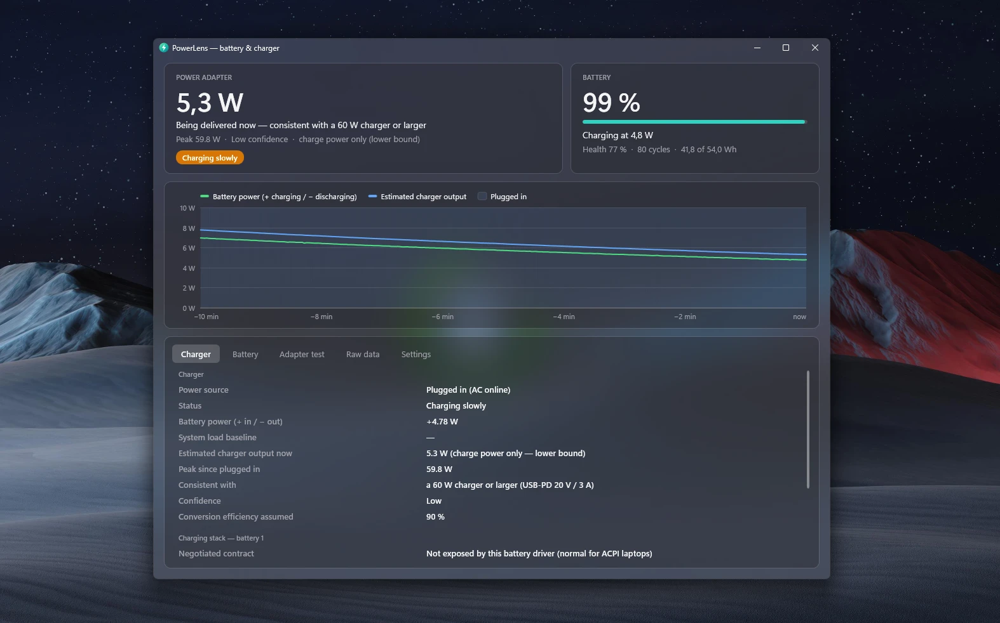

<p align="center">
  
</p>

<h1 align="center">PowerLens</h1>

<p align="center">
  Battery and USB-C charger inspector for Windows 10 and 11.<br>
  <b>How many watts is my charger actually delivering?</b>
</p>

<p align="center">
  <a href="https://github.com/kdoul/PowerLens/releases/latest"></a>
  <a href="https://github.com/kdoul/PowerLens/actions/workflows/ci.yml"></a>
  <a href="LICENSE"></a>
</p>

<p align="center">
  <a href="https://kdoul.github.io/PowerLens/">Website</a> ·
  <a href="https://github.com/kdoul/PowerLens/releases/latest/download/PowerLens-win-x64.zip">Download (x64)</a> ·
  <a href="https://github.com/kdoul/PowerLens/releases/latest/download/PowerLens-win-arm64.zip">Download (ARM64)</a>
</p>

<p align="center">
  
</p>

Think coconutBattery, for Windows. PowerLens shows your battery's health, cycle count and live power, and
measures how much power your USB-C charger is supplying. On Windows 11 22H2 and later the window uses
the system **acrylic** backdrop and follows the light/dark theme; earlier versions get solid colours.

## Install

1. Download **PowerLens-win-x64.zip** (Intel/AMD) or **PowerLens-win-arm64.zip** (Snapdragon/ARM) from the
   [latest release](https://github.com/kdoul/PowerLens/releases/latest).
2. Extract it and run `PowerLens.exe`. Nothing is installed, and no admin rights are needed.
3. PowerLens checks GitHub for new releases and offers to update itself: it downloads the zip for your
   PC, verifies it against the release's `SHA256SUMS.txt`, replaces its exe and restarts.

PowerLens isn't code-signed yet, so SmartScreen may show "Windows protected your PC" on first launch.
Choose **More info → Run anyway**. Every release is built from this repository by
[GitHub Actions](.github/workflows/release.yml), with SHA-256 checksums attached.

## Features

- **Charger card:** the reported charger rating when Windows exposes it. Otherwise, an estimate of the
  power coming from the charger now, the peak since it was plugged in, and the smallest standard
  USB-C/PD rating that fits (for example "consistent with a 45 W charger or larger").
- **Battery card:** charge %, charge/discharge power, health (full ÷ design capacity), cycle count,
  voltage, current, temperature, chemistry, manufacturer, serial number, and manufacture date.
- **Live chart:** battery power and estimated charger output for the last 10 minutes, with
  plugged-in periods shaded.
- **Adapter test:** a guided 1-minute measurement (unplug → plug back in) that gives the most
  accurate charger estimate the hardware allows.
- **Raw data:** every IOCTL result, the `root\WMI` battery classes, and any vendor WMI classes that
  look charger-related. You can copy or save it as a text report.
- **System tray:** an optional tray icon that shows the live battery wattage (green while charging,
  slate while discharging, red when the charger is too weak). Its menu has status lines and quick
  settings: watts in the icon, close-to-tray, and Start with Windows.
- **Settings tab:** the same options. Settings are saved to `%APPDATA%\PowerLens\settings.json`.
  Start with Windows uses the per-user Run key and launches into the tray with `--tray`.
- **Updates:** checks GitHub releases daily (optional) and updates itself in place after verifying the
  download's SHA-256 checksum. Also available from the tray menu.
- **CLI** (`powerlens-cli`): text report, `--json`, or `--watch` for a live line every 2 s.

No admin rights needed.

## Where the numbers come from

| Data | Windows API |
| --- | --- |
| Battery details & live status | Battery class driver: `IOCTL_BATTERY_QUERY_INFORMATION` / `IOCTL_BATTERY_QUERY_STATUS` (same source as `powercfg /batteryreport`) |
| AC online, aggregate rate | `CallNtPowerInformation(SystemBatteryState)` |
| Cycle-count fallback | WMI `root\WMI` `BatteryCycleCount` (many ACPI firmwares report 0 through the IOCTL) |
| **Negotiated USB-C contract** (V × A) | `BatteryChargerStatus` / `BatteryChargingSource` IOCTL levels → `BATTERY_USB_CHARGER_STATUS` |
| **Vendor-reported adapter wattage** | Any numeric `*Watt*` property in Dell / HP / Lenovo / ASUS / Surface WMI namespaces |
| **Estimated charger output** | Derived: (system load + battery charge power) ÷ 90 % conversion efficiency |

### Why the wattage is often an estimate

Windows has **no public user-mode API for the USB-PD contract**. Your laptop negotiates the contract
in its embedded controller (UCSI), and Windows only uses it internally, for example for the
"slow charger" notification. PowerLens shows a hard number only in these cases:

1. The battery driver implements the charger-status IOCTL levels. Some devices built on the Windows
   charging stack do; most x86 ACPI laptops don't.
2. An OEM tool publishes it in WMI. For example, Dell Command | Monitor publishes it in
   `root\dcim\sysman`.

Otherwise PowerLens measures what the charger is delivering:

- **On battery**, the discharge rate is the system load. PowerLens remembers it as a baseline for
  30 minutes.
- **Plugged in**, the charger supplies system load + battery charge power + conversion losses.
- Laptops cap their own intake, and charging slows above about 80 %. So the measured figure is a
  **lower bound**: the charger is rated at least that high, never lower. For the best figure, run the
  **Adapter test** below 80 % battery with the laptop idle.
- If the battery drains while plugged in, the status shows **Charger too weak**. This is typical
  for phone chargers or non-PD sources.

### How Windows decides a charger is "slow"

Windows doesn't measure this itself. The laptop's embedded controller compares the negotiated USB-PD
contract with what the machine needs and reports a charging status of nominal, slow, very slow or not
charging. On most laptops it does this through UCSI `GET_CONNECTOR_STATUS`. Windows only turns that
flag into the "Slow charger" / "PC isn't charging" notification. No public user-mode API exposes the
flag, so PowerLens shows its own verdict from measured power: **Charging slowly** (under 20 W
delivered) or **Charger too weak** (the battery drains while plugged in).

## Privacy

PowerLens's only network access is the update check: about once a day it asks the GitHub API for this
repository's latest release (a plain request with no data about your PC). You can turn it off under
**Settings → Check for updates automatically**. Settings are stored locally in `%APPDATA%\PowerLens`.

## Build from source

You need the [.NET 10 SDK](https://dotnet.microsoft.com/download). It builds on Windows, macOS, or Linux
(`EnableWindowsTargeting`), but only runs on Windows.

```bash
dotnet test
```

```bash
dotnet run --project src/PowerLens.App
```

Single-file, self-contained executables (no .NET install needed on the target PC):

```bash
dotnet publish src/PowerLens.App -c Release -r win-x64 --self-contained -p:PublishSingleFile=true -p:IncludeNativeLibrariesForSelfExtract=true -p:PublishReadyToRun=true -o publish/app
```

```bash
dotnet publish src/PowerLens.Cli -c Release -r win-x64 --self-contained -p:PublishSingleFile=true -p:PublishReadyToRun=true -o publish/cli
```

For Snapdragon / ARM64 Windows laptops, use `-r win-arm64`.

## Releasing

Releases are automated. Add the version's notes to [CHANGELOG.md](CHANGELOG.md), then push a tag:

```bash
git tag v0.2.0 && git push origin v0.2.0
```

The [release workflow](.github/workflows/release.yml) runs the tests, builds x64 and ARM64 packages,
and publishes a GitHub release with the changelog section as notes. The website in [`docs/`](docs/)
deploys to GitHub Pages on every push to `main` that touches it.

## Layout

```
src/PowerLens.Core   battery IOCTL + WMI readers, struct decoding, charger estimator, adapter test (net10.0)
src/PowerLens.App    WPF UI with acrylic backdrop and tray icon (net10.0-windows)
src/PowerLens.Cli    console report / --json / --watch (net10.0-windows)
tests/               xUnit tests for decoding and estimation logic (run on any OS)
tools/IconGen        renders the app icon (SkiaSharp): dotnet run --project tools/IconGen
docs/                GitHub Pages website
```

## License

[MIT](LICENSE) © Konstantinos Douloudis
